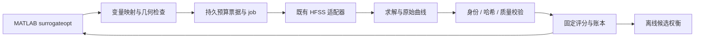

# MATLAB surrogateopt × HFSS Skill

面向昂贵电磁仿真的 AI agent skill：用 MATLAB `surrogateopt` 驱动 HFSS，并处理预算、热启动、断点恢复、结果校验和候选取舍。

**An agent skill for reliable MATLAB–HFSS optimization, with practical lessons from NGD filter workflows.** Documentation is primarily in Chinese. The skill includes English discovery metadata, a synthetic MATLAB demo, and a dependency-free Python candidate reporter.

本项目将实际工作流经验整理成可复用的指导，重点是少浪费一次昂贵仿真，并清楚说明每条结果的来源。它不是即装即用的 HFSS 求解服务，也不附带专有工程、许可证或优化数据。

## 能做什么

| 能力 | 解决的问题 |
|---|---|
| MATLAB 与 HFSS 接口设计 | 决策变量、派生尺寸与实际 HFSS 变量不一致 |
| 独立预算与 checkpoint 恢复 | 重启后重复求解、丢失回调、超出新增仿真预算 |
| 仿真/评分身份分离 | 目标改变后旧 Fval 被错误复用；模型设置改变后命中旧缓存 |
| 结果发布与恢复约定 | 部分 CSV 被读取、重复 job、完成响应早于曲线 |
| 离线候选比较 | J 变好而 S21、S11 或群时延反而变差 |
| NGD 滤波器经验 | 三谐振器＋双馈线＋有损耦合、四曲线目标与精度复核 |



## 安装

仓库根目录就是 skill，入口为 [SKILL.md](SKILL.md)。在支持 `SKILL.md` 的 agent 中按其本机约定安装整个文件夹。Codex 的一个手动安装示例：

```powershell
$skillBase = if ($env:CODEX_HOME) { Join-Path $env:CODEX_HOME 'skills' } else { Join-Path $env:USERPROFILE '.codex\skills' }
New-Item -ItemType Directory -Force -Path $skillBase | Out-Null
git clone https://github.com/bingrugaohuang/matlab-surrogateopt-hfss-skill.git (Join-Path $skillBase 'matlab-surrogateopt-hfss')
```

若目标目录已存在，先查看本地修改再更新；不要覆盖自定义 skill。安装只放置文本和示例，不启动求解。其他支持 agent skills 的客户端可按其文档选择安装目录；本项目未逐一验证所有客户端。

## 使用示例

```text
使用 $matlab-surrogateopt-hfss 检查这个 MATLAB-HFSS 优化流程。
当前仿真仍在运行，只做只读检查，并把改进建议写入独立目录。
重点确认续跑 options、实际 HFSS 次数和旧样本是否能复用。
```

```text
使用 $matlab-surrogateopt-hfss 为我的三谐振器 NGD 滤波器设计优化闭环。
保留现有 AEDT 原生脚本后端。先做离线准备，列出接入条件和单点验收步骤。
```

```text
使用 $matlab-surrogateopt-hfss 比较已有候选。
分别给出总分最佳、S21 最佳和折中候选，说明相对基准的退化指标。
```

## 不需要 HFSS 的快速体验

Python 3.10+，仅标准库：

```text
python scripts/candidate_report.py examples/candidates.synthetic.json
python -m unittest discover -s tests -v
```

合成数据特意包含“总分最佳但 S21 较差”的点，以及失败记录和重复记录。输出包含排除原因、各指标最佳、非支配集合和按归一化最大误差选择的折中点。字段与局限见 [examples/README.md](examples/README.md)。

MATLAB 示例需要 Global Optimization Toolbox：在独立 MATLAB 会话中进入 `examples`，运行 `demo_surrogateopt_mock`。示例只调用解析函数，在新临时目录写入 checkpoint/options/result；没有 HFSS 接入代码，也不接触任何现有优化。

## 仓库结构

```text
SKILL.md                 agent 入口
agents/openai.yaml       Codex UI 元数据
references/              工作流、预算、恢复、排错、NGD、验收、来源
examples/                合成候选与 MATLAB mock
scripts/                 只读候选比较器
tests/                   离线行为测试
docs/validation.md       当前发布的验证范围
CONTRIBUTING.md          贡献与复现要求
LICENSE                  MIT
```

## 经验与验证边界

经验来自 Windows 上 MATLAB R2024b 与 AEDT 2026 R1 的 NGD 优化工作流。已有工程使用过原生 AEDT 脚本队列；后续严格身份、原子发布等增强曾在隔离副本进行离线验证，不能因此认定已完成真实 MATLAB/HFSS 闭环验证。

本仓库重新编写通用指导和最小示例，**没有搬运原工程服务端**。当前可执行功能是离线候选比较；真实 HFSS 适配器、许可证、模型变量和网格质量需在使用者环境验证。详见 [验证记录](docs/validation.md) 和 [验收流程](references/validation.md)。

## 来源与许可

组织方式参考 [MathWorks MATLAB agentic toolkit](https://github.com/matlab/matlab-agentic-toolkit) 和 [LZT001107/hfss-api-skill](https://github.com/LZT001107/hfss-api-skill)。仅借鉴分层文档与工作流表达方式，没有复制这两个仓库的实现或整篇 skill；它们各自的许可独立适用。官方 API、文献和参考文件链接见 [sources.md](references/sources.md)。

原创文档与示例采用 [MIT License](LICENSE)。MATLAB、Ansys HFSS 和相关商标属于各自所有者；本项目与其无官方隶属关系。欢迎以脱敏最小复现提交 issue 或 PR。
